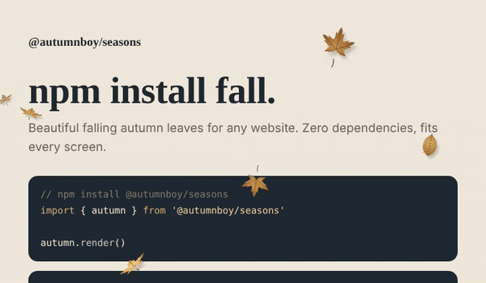

# @autumnboy-studio/seasons 🍂

**`npm install fall`**: beautiful falling autumn leaves for any website.

[](https://www.npmjs.com/package/@autumnboy-studio/seasons)
[](https://github.com/autumnboy-travel/seasons/actions/workflows/ci.yml)
[](https://bundlejs.com/?q=@autumnboy-studio/seasons)
[](./LICENSE)



**[Live demo →](https://autumnboy-travel.github.io/seasons/)**

- **Fits every screen:** fewer leaves on phones, more on big screens, and it follows resizing and rotation.
- **Stays out of the way:** it never blocks clicks, is hidden from screen readers, pauses when the tab is hidden, and respects "reduce motion".
- **Tiny and safe:** zero dependencies, no install scripts, no tracking, no network requests.
- **Works everywhere:** React, Vue, Svelte, Angular, Next.js, or plain HTML (WordPress, Shopify, Wix…).

## Install

```bash
npm install @autumnboy-studio/seasons
```

```js
import { autumn } from '@autumnboy-studio/seasons'

autumn.render()
```

### Without npm

Paste this into any page:

```html
<script src="https://cdn.jsdelivr.net/npm/@autumnboy-studio/seasons@0"></script>
<script>Seasons.autumn.render()</script>
```

## Options

```js
autumn.render({
  count: 'auto',      // number of leaves, or 'auto' to fit the screen (8 to 40)
  speed: 1,           // 0.1 to 5
  size: 1,            // 0.3 to 3
  wind: 0,            // -5 (left) to 5 (right)
  colors: 'mixed',    // 'golden', 'warm', 'mixed', '#e3961c', or ['#ffd65a', ['#f2853a', '#a8301a']]
  opacity: 1,         // 0 to 1
  container: null,    // an element to fill instead of the whole page
  zIndex: 2147483000, // stacking order of the overlay
  maxPixelRatio: 2,   // caps sharpness to keep phones fast
  reducedMotion: 'respect', // 'respect' shows nothing to users who prefer reduced motion
  pauseWhenHidden: true,
  seed: null,         // a whole number gives the same layout every time
})
```

Calling `render()` again restarts the leaves with the new options. Unknown or invalid options throw a clear error.

## Controls

```js
autumn.pause()     // freeze the leaves
autumn.resume()    // continue
autumn.stop()      // remove everything the package added
autumn.isRunning   // true while leaves are moving
```

## Framework examples

<details>
<summary>React</summary>

```jsx
import { useEffect } from 'react'
import { autumn } from '@autumnboy-studio/seasons'

export function AutumnLeaves() {
  useEffect(() => {
    autumn.render()
    return () => autumn.stop()
  }, [])
  return null
}
```
</details>

<details>
<summary>Vue</summary>

```vue
<script setup>
import { onMounted, onUnmounted } from 'vue'
import { autumn } from '@autumnboy-studio/seasons'

onMounted(() => autumn.render())
onUnmounted(() => autumn.stop())
</script>
```
</details>

<details>
<summary>Only inside one element</summary>

```js
autumn.render({ container: document.querySelector('#hero'), count: 12 })
```
</details>

Server-side rendering is safe: importing the package never touches `window`, and `render()` does nothing on the server.

## Try it in your terminal

```bash
npx @autumnboy-studio/seasons
npx @autumnboy-studio/seasons --demo   # opens the live demo
```

## Browser support

All modern browsers: Chrome, Edge, Firefox, Safari (desktop and mobile).

## Coming later

`winter` (snowflakes ❄️), `spring` (blossom petals 🌸) and `summer` (fireflies ☀️), with the same `render()` API.

## Development

```bash
npm run build   # writes dist/
npm test        # Node's built-in test runner
npm run check   # build + test + preview of the published files
```

Open `demo/index.html` after building to try it locally.

## License

[MIT](./LICENSE). Made with love 🍂 by [autumnboy.travel](https://autumnboy-travel.pages.dev/).
